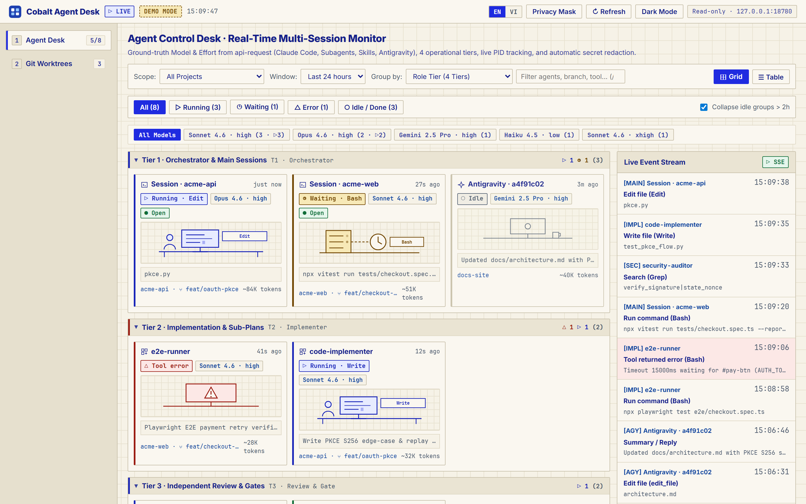
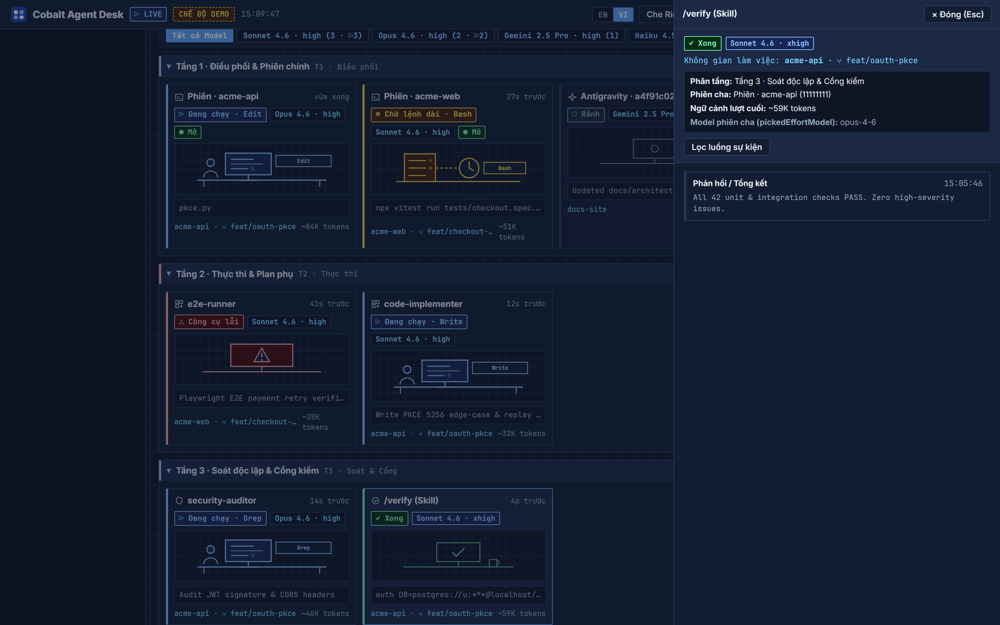

# Cobalt Agent Desk

[](LICENSE)
[](pyproject.toml)
[-0f6d38.svg)](pyproject.toml)

[English](README.md) · [Tiếng Việt](README.vi.md)

**Cobalt Agent Desk** is a zero-dependency, **100% read-only** local control desk (`127.0.0.1:18780`) for monitoring parallel **Claude Code** sessions, **Subagents**, `/skill` forks, **Google Antigravity** conversations, and **Git worktrees** in real time.





---

## Why We Built This

When running 3–5 AI coding sessions and dozens of subagents in parallel across multiple Git worktrees, it quickly becomes hard to answer:
- **Which model & effort is a subagent *actually* running?** (In Claude Code `.meta.json`, `pickedEffortModel` reflects the *parent* session's model rather than the subagent's real `api-request` model/effort.)
- **Which session tab is still alive vs. closed, waiting on a long test run, or stuck on a tool error?**
- **Which subagent belongs to which parent session and Git branch?**

**Cobalt Agent Desk** answers all of these in a lightweight browser tab without installing Node packages, databases, background daemons, or cloud telemetry.

---

## Key Features

- **Zero External Dependencies**: Pure Python 3.10+ standard library (`http.server` + SSE) and plain HTML/CSS/JS — works offline out of the box.
- **Ground-Truth Model & Effort**: Reads actual `api-request` payloads (adaptive `64KB -> 256KB` tail byte-seeking, stripping `<synthetic>` and provider/date suffixes across Anthropic API, Bedrock, and Vertex) instead of trusting inherited parent metadata.
- **5 Grouping Views & 4 Operational Tiers**:
  - **Role Tier**: `T1` Orchestrator & Main Sessions · `T2` Implementation · `T3` Review & Gates · `T4` Survey & Background
  - **Model & Effort**, **Agent Function**, **Session Tree → Branch → Subagents**, and **Flat** (Grid or Ledger Table, with Lazy DOM rendering for collapsed groups).
- **Cross-Platform Live PID Detection (`● Open / ○ Closed`)**: Read-only Win32 `OpenProcess` on Windows and `os.kill` + `/proc/<pid>/stat` zombie/reuse guards on Linux & macOS.
- **Built-in Secret Redaction & Privacy Mask**: Masks API keys, `Bearer`/`Basic` headers, `Cookie`, DSNs, URL tokens, `curl -u`, query-string tokens, webhooks, and multi-line PEM keys before data leaves Python, plus a 1-click **`Privacy Mask`** button in the UI for safe screen-sharing.
- **Optional Git Worktrees Radar (`--repo`)**: Inspects parallel agent worktrees using `git --no-optional-locks` so active coding agents **never** hit `.git/index.lock` errors.
- **Bilingual UI (`EN | VI`) & Architectural Blueprint Theme**: Warm-paper **Cobalt Cream** light mode and high-contrast **Cobalt Dark** mode.

---

## Quickstart (3 Seconds)

### Option 1 — Instant Run via `uvx` (No Clone Required)

Try with synthetic sample data (`--demo`, touches zero real files):
```bash
uvx --from git+https://github.com/TrungTV76/cobalt-agent-desk cobalt-agent-desk --demo --open-browser
```

Or monitor your live local Claude Code & Antigravity sessions:
```bash
uvx --from git+https://github.com/TrungTV76/cobalt-agent-desk cobalt-agent-desk --open-browser
```

### Option 2 — Clone & Run with Python 3.10+

```bash
git clone https://github.com/TrungTV76/cobalt-agent-desk.git
cd cobalt-agent-desk

# Windows
python server.py --open-browser

# macOS / Linux
python3 server.py --open-browser
```

Try the isolated synthetic demo mode first:
```bash
python server.py --demo --open-browser
```

Enable the optional **Git Worktrees Radar** tab for a multi-worktree repository:
```bash
python server.py --repo /path/to/your/git-repo --open-browser
```

### WSL2 & Remote SSH Tips

- **Monitoring WSL2 sessions from Windows (or vice versa)**:
  ```bash
  python server.py --claude-dir "\\wsl.localhost\Ubuntu\home\<user>\.claude"
  ```
- **Remote SSH / Devcontainer** (server binds strictly to `127.0.0.1` for security — forward the port over SSH):
  ```bash
  ssh -L 18780:127.0.0.1:18780 user@remote-devbox
  ```

---

## CLI Options

| Flag | Default | Description |
|---|---|---|
| `--demo` | `off` | Launch with 100% synthetic demo sessions & worktrees in an isolated temp folder |
| `--repo PATH` | disabled | Path to a Git repository to enable Tab `2 · Git Worktrees` (`git --no-optional-locks`) |
| `--port PORT` | `18780` | Preferred localhost port (auto-increments if busy unless `--strict-port` is set) |
| `--open-browser` | `off` | Automatically open the bound URL in your default browser |
| `--claude-dir PATH` | `~/.claude` | Override `.claude` root directory |
| `--antigravity-dir PATH` | `~/.gemini/antigravity/brain` | Override Antigravity `brain` directory |
| `--strict-port` | `off` | Exit with an error instead of falling back if `--port` is occupied |

Helper background scripts are also provided in [`scripts/start.ps1`](scripts/start.ps1) (Windows PowerShell: `-Background`, `-Restart`, `-Stop`) and [`scripts/start.sh`](scripts/start.sh) (macOS / Linux: `--background`, `--restart`, `--stop`).

---

## Security & Read-Only Guarantees

- Binds **exclusively** to `127.0.0.1` / `localhost` / `::1`.
- Enforces `Host`, `Origin`, and `Sec-Fetch-Site` validation (DNS-rebinding & cross-origin protection) and strict `Content-Security-Policy: script-src 'self'`.
- Opens session files strictly read-only and runs `git --no-optional-locks`.
- See [SECURITY.md](SECURITY.md) for full details and screenshot privacy tips.

---

## Roadmap & Community Feedback Wanted

We are actively gauging community interest! Open a [Discussion](https://github.com/TrungTV76/cobalt-agent-desk/discussions) or [Issue](https://github.com/TrungTV76/cobalt-agent-desk/issues) to vote on or contribute:

- [ ] **New Agent Adapters** (`cobalt_desk/adapters/`): OpenAI **Codex CLI**, **Cursor**, **Cline / Roo Code**, **Windsurf**, **OpenCode**, **Gemini CLI**, **Aider**
- [ ] Optional desktop / sound notification when an agent hits `ERROR` or finishes a long test suite
- [ ] Session token & cache efficiency trends

See [CONTRIBUTING.md](CONTRIBUTING.md) for the step-by-step guide to adding a new adapter in ~80 lines of stdlib Python.

---

## License

- Source code: [MIT License](LICENSE)
- Bundled unmodified webfonts (`Inter`, `JetBrains Mono`): [SIL Open Font License 1.1](THIRD_PARTY_LICENSES.md)
