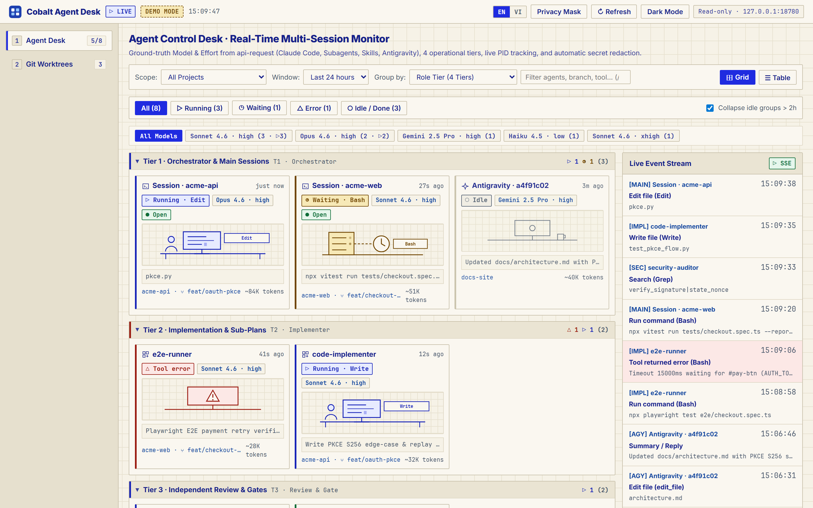
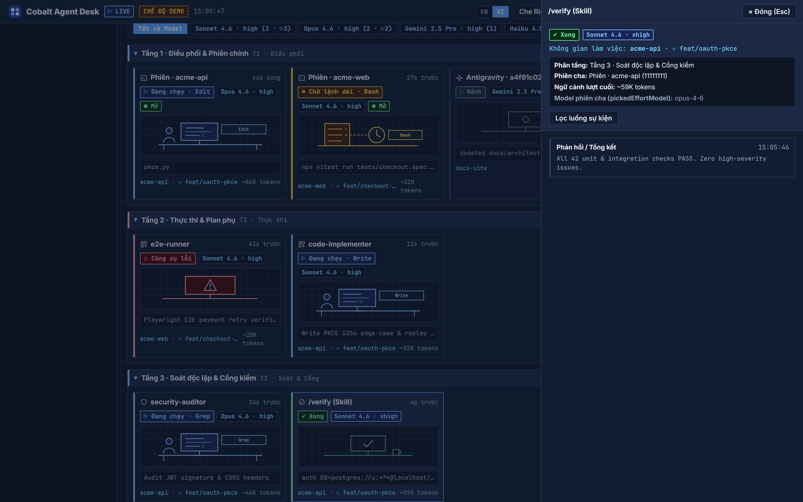

# Cobalt Agent Desk (Tiếng Việt)

[English](README.md) · [Tiếng Việt](README.vi.md)

**Cobalt Agent Desk** là bàn điều hành cục bộ **0 thư viện ngoài**, **chỉ-đọc 100%** (`127.0.0.1:18780`) giúp theo dõi thời gian thực nhiều phiên **Claude Code**, **Subagents**, kỹ năng `/skill`, **Google Antigravity** và các nhánh **Git worktree** đang chạy song song trên máy của bạn.





---

## Giải quyết bài toán gì khi Vibe Coding đa phiên?

Khi mở song song nhiều cửa sổ Claude Code + hàng chục subagent + Antigravity trên nhiều worktree:
- **Subagent thực sự đang chạy model & mức effort nào?** (Trong `.meta.json` của Claude Code, `pickedEffortModel` luôn ghi model của *phiên cha*, dễ gây nhầm lẫn — công cụ này đọc thẳng bản ghi `api-request` để lấy đúng model & effort thực chạy).
- **Tab phiên chính nào còn đang mở (`● Mở`) hay đã tắt (`○ Đóng`), tác tử nào đang chờ test dài hay vừa gặp lỗi công cụ?**
- **Tác tử phụ thuộc về phiên cha nào và đang chạm nhánh Git nào?**

Tất cả gói gọn trong 1 tiến trình Python chuẩn (stdlib), không cần cài npm/database, không gửi bất kỳ dữ liệu nào ra ngoài máy.

---

## Chạy thử trong 3 giây

### Cách 1 — Chạy ngay 1 dòng bằng `uvx` (không cần clone)

Xem thử bằng dữ liệu giả lập sạch (`--demo`, không đọc bất kỳ tệp thật nào trên máy):
```bash
uvx --from git+https://github.com/TrungTV76/cobalt-agent-desk cobalt-agent-desk --demo --open-browser
```

Theo dõi trực tiếp các phiên Claude Code & Antigravity trên máy bạn:
```bash
uvx --from git+https://github.com/TrungTV76/cobalt-agent-desk cobalt-agent-desk --open-browser
```

### Cách 2 — Clone về máy & chạy bằng Python 3.10+

```bash
git clone https://github.com/TrungTV76/cobalt-agent-desk.git
cd cobalt-agent-desk

# Windows
python server.py --open-browser

# macOS / Linux
python3 server.py --open-browser
```

Bật thêm tab **2 · Đa Làn Git (Git Worktrees)** cho dự án có nhiều worktree:
```bash
python server.py --repo /duong/dan/git-repo --open-browser
```

Chạy nền tiện lợi bằng script đi kèm:
```powershell
# Windows PowerShell
powershell -ExecutionPolicy Bypass -File .\scripts\start.ps1 -Background
# Dừng server nền:
powershell -ExecutionPolicy Bypass -File .\scripts\start.ps1 -Stop
```

---

## Điểm nổi bật về An toàn & Quyền riêng tư

- **Chỉ lắng nghe tại `127.0.0.1`** + kiểm tra chặt `Host`, `Origin`, `Sec-Fetch-Site` và `CSP: script-src 'self'`.
- **Không khóa Git**: mọi lệnh kiểm tra worktree đều chạy kèm `git --no-optional-locks`, tuyệt đối không tạo `.git/index.lock` làm vướng agent đang code.
- **Tự động che bí mật (`***`)**: tự động ẩn API keys, `Bearer`/`Basic`, `Cookie`, mật khẩu trong URL kết nối DB/Git, `curl -u`, query token và khóa PEM trước khi hiển thị.
- **Nút `Che Riêng Tư` (`Privacy Mask`)**: bấm 1 nút trên thanh công cụ để ẩn ngay tên dự án, tên nhánh và chi tiết lệnh trước khi bạn chụp màn hình chia sẻ lên diễn đàn.

---

## Đóng góp & Mở rộng Adapter

Rất hoan nghênh mọi góp ý, báo lỗi và Pull Request! Nếu bạn muốn bổ sung bộ đọc (adapter) cho **Codex CLI**, **Cursor**, **Cline**, **Windsurf**, **OpenCode** hoặc **Gemini CLI**, xem hướng dẫn từng bước trong [CONTRIBUTING.md](CONTRIBUTING.md).

Giấy phép: [MIT License](LICENSE) · Bản quyền font chữ: [THIRD_PARTY_LICENSES.md](THIRD_PARTY_LICENSES.md).
